# STRUKTUR.md: Fondasi Proyek Kecaknik Food

Versi 2.0 · 17 November 2026 · Skripsi: *Rancang Bangun Sistem Pemesanan Makanan pada Kecaknik Food Menggunakan Metode Scrum dengan Framework React JS dan Express.js*

**Perubahan dari v1.2:** QRIS dibuang, diganti transfer (DANA, BCA, BRI, GoPay), bayar di tempat (tunai), dan split. Tombol WhatsApp dengan pesan terisi otomatis (tautan `wa.me`) di halaman status pelanggan dan detail pesanan admin. Mini peta OSM di detail pesanan admin. Komponen UI bersama dan validasi input per jenis. Footer dan responsif di semua halaman. Dibangun dari nol (tanpa kode Warkopolo). Ongkir di luar sistem. Kebocoran koordinat di v1.2 (BR-14 vs peta status) diperbaiki.

---

## 0. Cara memakai dokumen ini

**Untuk manusia:** sumber kebenaran tunggal untuk Bab 3 (UML) dan Bab 4 (implementasi). Bagian 10 berisi bahan gambar use case, activity, sequence, dan class diagram. Tampilan ada di `DESIGN.md`, aturan kerja AI di `CLAUDE.md`, status dan daftar unit pekerjaan di `HANDOFF.md`, prompt siap pakai di `PERINTAH.md`.

**Untuk AI (Claude):**
1. Baca `CLAUDE.md`, lalu dokumen ini sebelum menulis kode. Jika kode bertentangan dengan dokumen ini, dokumen ini yang benar.
2. Jangan membuka atau menampilkan isi `.env`.
3. Jangan menambah fitur di luar bagian 2. Dilarang: QRIS, payment gateway, bot atau API WhatsApp otomatis, akun pelanggan, banyak admin, grafik, ongkir otomatis, kuota PO, pelacakan kurir real-time, deployment cloud.
4. Saat ada hal belum diputuskan, pakai **default** di bagian 3 dan sebutkan di jawaban.
5. Bedakan: `[TERKUNCI]` keputusan pemilik skripsi, `[DEFAULT]` dan `[SARAN]` usulan yang belum dikonfirmasi.
6. Tulis nama kolom, endpoint, dan kelas dalam Bahasa Indonesia.

**Belum diverifikasi:** belum ada kode. Nomor rekening, nomor WhatsApp admin, alamat dan koordinat toko, serta harga add-on belum diketahui (placeholder, lihat D-01, D-15, D-16, D-17).

---

## 1. Ringkasan proyek

| Item | Isi |
|---|---|
| Objek | Kecaknik Food, UMKM kuliner (kue, puding, gorengan, makanan berat) |
| Masalah | Pesanan dari WhatsApp, Facebook, dan langsung dicatat terpisah di buku dan ponsel |
| Solusi | Sistem web pemesanan terpusat dengan pemantauan status, pencatatan pembayaran, dan laporan penjualan |
| Stack | React (Vite, JavaScript), Express.js REST API, MySQL/MariaDB (XAMPP, lokal) |
| Metode | Scrum, 4 sprint. Pemilik = Product Owner, penulis = Scrum Master + Developer |
| Kerangka | Dibangun dari nol. Dua aplikasi React (pelanggan, admin) memakai satu pustaka `shared` |

**Tiga rumusan masalah (patokan fitur, Bab 1.3):**
- **RM1:** pencatatan pesanan terpusat dari berbagai kanal.
- **RM2:** pemantauan tahapan pesanan dan rekapitulasi penjualan.
- **RM3:** pencatatan pembayaran (belum dibayar, uang muka, lunas) yang bisa ditelusuri kembali.

**Aktor:** `Admin` (pemilik, satu akun) dan `Pelanggan` (tanpa akun).

---

## 2. Keputusan desain

### 2.1 Keputusan terkunci

| Kode | Keputusan |
|---|---|
| K-01 | [TERKUNCI] Dua peran: admin (satu akun, password di `.env`, login JWT sederhana) dan pelanggan (tanpa akun, langsung memesan, nama, nomor WhatsApp, dan alamat diisi di checkout) |
| K-02 | [TERKUNCI] Tidak ada fitur meja atau makan di tempat. Cara terima: **Ambil** dan **Antar** |
| K-03 | [TERKUNCI] Sistem **tidak memproses** pembayaran. Tiga metode: **Transfer** (pelanggan memilih DANA, BCA, BRI, atau GoPay, nomor rekening tampil dengan tombol Salin, bukti wajib), **Bayar di tempat (tunai)** (bayar saat ambil atau saat diterima, tanpa bukti, dicatat admin), dan **Split** (sebagian lewat transfer sekarang dengan bukti wajib, sisanya tunai saat terima). Tombol Pesan nonaktif sampai channel dipilih dan file bukti ada (transfer dan split). Admin memverifikasi bukti lalu status pembayaran terhitung otomatis. Tanpa QRIS, tanpa payment gateway |
| K-04 | [TERKUNCI] Pengantaran memakai Leaflet + OpenStreetMap (tanpa Google Maps API). Tombol "Gunakan lokasi saya" (`navigator.geolocation`) menggeser marker. Pilih titik manual tetap ada |
| K-05 | [TERKUNCI] Pre-order (model D, tanpa kuota): produk punya `is_preorder`, `tanggal_buka`, `tanggal_tutup`, `tanggal_ambil`. Produk PO tetap di kategori aslinya dengan label "Pre-order" dan juga muncul di tab "Pre-order" dan banner, semuanya dari satu data. PO yang lewat `tanggal_tutup` hilang lewat filter query (tanpa cron). Satu pesanan tidak boleh mencampur produk reguler dengan PO, atau PO dengan `tanggal_ambil` berbeda |
| K-06 | [TERKUNCI] Fitur yang dibuat: login admin, katalog, add-on dan catatan, keranjang, checkout, pembayaran (transfer, tunai, split), status pesanan, input pesanan manual (kolom sumber), laporan sederhana (SUM per hari atau bulan, tabel, tanpa grafik), pre-order, tombol WhatsApp |
| K-07 | [TERKUNCI] Demo lokal dengan XAMPP. Prioritaskan sederhana dan mudah didemokan. Hosting cloud di luar lingkup (saran Bab V) |
| K-08 | [TERKUNCI] Halaman status Antar memakai Leaflet + OSM: marker toko, marker lokasi, garis rute (OSRM, cadangan garis lurus), dan marker motor **statis** di titik toko saat `dikirim`. Tanpa animasi dan tanpa auto-PATCH. `dikirim` dan `selesai` hanya diubah admin lewat API. Sebut "peta rute pengantaran", bukan "pelacakan" |
| K-09 | [TERKUNCI] **WhatsApp lewat tautan `wa.me` dengan pesan terisi otomatis dari data pesanan** (templat Lampiran D). Pelanggan: tombol `TombolWa` tepat di bawah badge pembayaran dan blok status di halaman status (dan di halaman berhasil), mengirim detail pesanan ke WhatsApp admin. Admin: `TombolWa` di detail pesanan, templat terpilih otomatis sesuai status, mengirim ke nomor pelanggan. Pengguna tinggal menekan **Kirim** di WhatsApp. Ini bukan WhatsApp Business API dan bukan bot: tidak ada pengiriman otomatis di latar belakang. Nomor HP wajib, berlabel "Nomor WhatsApp", dinormalisasi ke format 62 (kecuali input manual dengan sumber `langsung`) |
| K-10 | [TERKUNCI] Pembatalan wajib `alasan_batal`. Pengembalian dana di luar sistem, dicatat sebagai pembayaran berstatus `dikembalikan` |
| K-11 | [TERKUNCI] Detail pesanan admin (Antar) menampilkan **mini peta OSM**: marker toko, marker pelanggan, garis rute. Tombol "Buka rute di Google Maps" (tautan koordinat, tanpa API key) tetap ada |
| K-12 | [TERKUNCI] Semua elemen interaktif dari komponen bersama `shared/ui` (tombol, field, dropdown, kartu pilihan, modal, dan seterusnya). Tampilan seragam di pelanggan dan admin |
| K-13 | [TERKUNCI] Input divalidasi per jenis (`Field kind`): nama tidak menerima angka, nomor tidak menerima huruf. Aturan di Lampiran E, dipakai klien dan server |
| K-14 | [TERKUNCI] Semua layar responsif (360 sampai 1440 px). Dropdown tidak keluar dari layar |
| K-15 | [TERKUNCI] Footer tampil di semua halaman pelanggan lewat `PelangganLayout` |
| K-16 | [DEFAULT] Ongkir dan area antar di luar sistem, disepakati lewat WhatsApp. UI menampilkan catatan "Ongkir dikonfirmasi admin lewat WhatsApp." Tidak ada baris ongkir di total |
| K-17 | [TERKUNCI] Dibangun dari nol. Tidak ada kode lama |

### 2.2 Add-on (opsi tambahan) dan catatan [TERKUNCI sebagai kebutuhan, detail teknis = DEFAULT]

Pelanggan dapat memilih opsi tambahan **sebelum menekan bayar**. Harga menyesuaikan otomatis. Ada juga catatan.

**Contoh dari pemilik skripsi (kue/puding ulang tahun):**
- Grup **"Lilin umur"**, pilih satu: opsi 1 = 1 lilin, opsi 2 = 2 lilin, dst.
- Setelah grup lilin umur dipilih, muncul grup **"Lilin nama"**. Pelanggan mengisi nama (contoh "Sadam") atau memilih paketnya.
- Setiap opsi dapat mengubah harga.

**Contoh pizza:** grup **"Topping tambahan"**, pilih banyak, setiap topping menambah harga.

**Interpretasi saya [DEFAULT, konfirmasi ke pemilik, lihat D-02]:**

| Hal | Default |
|---|---|
| Struktur | Produk punya 0..n **grup opsi**. Grup punya 1..n **opsi**. Opsi punya `harga_tambah` (boleh 0) |
| Tipe grup | `pilih_satu` atau `pilih_banyak`, dengan penanda `wajib` dan batas `min_pilih`/`max_pilih` |
| Grup bergantung | Grup dapat muncul hanya setelah grup lain terisi (`muncul_setelah_grup_id`). Contoh: "Lilin nama" muncul setelah "Lilin umur" |
| Opsi bertulisan | Opsi dapat meminta isian teks (`butuh_teks`), misalnya nama pada lilin |
| Rumus harga | `harga_satuan = harga_dasar + Σ harga_tambah`. `subtotal = harga_satuan × qty`. Add-on berlaku per unit |
| Beda opsi = beda baris | Produk sama dengan opsi berbeda adalah baris keranjang terpisah |
| Catatan | `orders.catatan` (umum) dan `order_items.catatan` (per produk, misalnya tulisan di kue) |
| Server menghitung | Klien hanya mengirim id opsi dan teks. Harga selalu dihitung ulang server dari DB |
| Tempat memilih | Modal pilih opsi saat "Tambah ke keranjang", bisa diubah di keranjang. Total berubah langsung |

Add-on tidak ada di Bab 1. Lihat bagian 12.

---

## 3. Keputusan terbuka (dengan default agar pekerjaan tidak berhenti)

| Kode | Pertanyaan | Default jika belum diputuskan | Dampak |
|---|---|---|---|
| D-01 | Daftar grup opsi, nama opsi, dan harga add-on tiap produk (lilin, topping) | Struktur dibuat, data seed berisi placeholder `TBD`. Jangan mengarang harga | Seed, Bab 4 |
| D-02 | Lilin nama: harga tetap per opsi atau per huruf? Apakah "kue ulang tahun" = "Puding ultah"? | Harga tetap per opsi, isian teks tanpa pengali. Add-on dipasang di Puding ultah dan Pizza | Skema, rumus harga |
| D-03 | Kapan Split dipakai dan apakah nominal transfer dibatasi | Pelanggan bebas memilih, syarat `0 < nominal < total`. Chip 25% dan 50% dibulatkan ke Rp500 | RM3 |
| D-05 | Tanggal acuan laporan | `created_at` (WIB). Pesanan `dibatalkan` dikecualikan | Laporan |
| D-06 | Omzet dihitung dari mana | Dua kolom berdampingan: **total tagihan** dan **total diterima** | Laporan |
| D-08 | Aturan PO untuk input manual admin | Admin tidak boleh melanggar aturan campur. Pesanan dipecah dua | Validasi |
| D-09 | Produk PO sebelum `tanggal_buka` | Disembunyikan | `GET /products` |
| D-10 | Boleh `selesai` saat belum lunas? | Boleh (tunai dibayar saat serah terima). Admin tetap bisa mencatat pembayaran sesudahnya | Status |
| D-11 | Akses file bukti | Folder statis dengan nama acak 32 heksa. Alternatif: endpoint ber-token | Keamanan |
| D-12 | Admin app terpisah atau digabung | Terpisah (`admin-app`), berbagi `shared`, demo 3 terminal | Struktur |
| D-13 | Kelebihan bayar | Ditolak server | Validasi |
| D-14 | Maksimal qty per item | 99 | Validasi |
| D-15 | Rekening: nomor dan atas nama DANA, BCA, BRI, GoPay (channel mana yang benar-benar ada) | Empat channel dengan nomor `TBD` di `shared/core/konfigurasi.js`. Pemilik mengisi | UI, Bab 4 |
| D-16 | Nomor WhatsApp admin untuk tombol pelanggan | `konfigurasi.js` (`waAdmin`). Kosong = tombol tampil nonaktif dengan teks bantu "Nomor admin belum diatur" (hanya di dev) dan disembunyikan di produksi | UI |
| D-17 | Alamat dan koordinat toko, jam buka | Placeholder di `konfigurasi.js` | Peta, footer |
| D-18 | Tombol "Buka rute di Google Maps" di admin | Dipasang | Admin |
| D-19 | Pustaka UI | `@radix-ui/react-select`, `@radix-ui/react-dialog`, `lucide-react`, `leaflet`, `@fontsource/archivo-black`, `@fontsource/inter`. CSS Modules + token CSS (tanpa Tailwind) | `shared/ui` |
| D-20 | Pembatasan percobaan (rate limit) | `GET /orders/kode/:kode` 60 per menit per IP, `POST /auth/login` 10 per menit per IP, dalam memori | Keamanan |

---

## 4. Hasil akhir sistem (output yang dibangun)

### 4.1 Bentuk

Tiga proses lokal: **backend** Express (port 5000), **customer-app** React (port 5173), **admin-app** React (port 5174). Basis data MySQL/MariaDB di XAMPP. Folder `backend/uploads/` menyimpan foto produk dan bukti bayar. Satu pustaka `shared` (`core` JS murni + `ui` komponen React) dipakai ketiganya.

### 4.2 Alur pelanggan
1. Buka katalog (4 kategori: Kue, Puding dan salad, Gorengan, Lainnya; tab Pre-order bila ada). Tanpa login.
2. Pilih produk. Jika produk punya opsi, modal opsi muncul (pilih opsi, isi teks bila diminta, catatan). Harga berubah langsung. Opsi bisa diubah lagi dari keranjang ("Ubah opsi").
3. Tambah ke keranjang, lanjut ke checkout satu halaman: **Ambil** atau **Antar** (Antar memakai peta), nama dan Nomor WhatsApp, lalu metode bayar.
4. Pilih **Transfer** (pilih channel, salin nomor rekening, unggah bukti), **Bayar di tempat (tunai)**, atau **Split** (isi nominal transfer, sisa tunai otomatis, unggah bukti). Tombol Pesan aktif setelah syarat terpenuhi.
5. Pesanan dibuat, pelanggan menerima `kode_pesanan` dan melihat halaman berhasil.
6. Halaman status menampilkan tahapan, status pembayaran, peta rute (Antar), dan `TombolWa` yang mengirim ringkasan pesanan ke WhatsApp admin dengan satu ketukan.

### 4.3 Alur admin
1. Login. Lihat daftar pesanan (sumber, status, status pembayaran), riwayat, dan filter.
2. Input pesanan manual dari WhatsApp, Facebook, atau langsung (dengan opsi dan catatan).
3. Buka detail: lihat item, bukti, dan (Antar) mini peta. Ubah status, atau batalkan (alasan wajib).
4. Verifikasi bukti transfer atau catat tunai atau pelunasan. Status pembayaran terhitung otomatis dari nominal.
5. Hubungi pelanggan lewat `TombolWa` (templat sesuai status, pesan terisi otomatis).
6. Kelola produk: foto, kategori, aktif, opsi tambahan, penanda pre-order.
7. Laporan penjualan: tabel total per hari dan per bulan.

### 4.4 Keterkaitan dengan rumusan masalah

| RM | Dijawab oleh | Sprint |
|---|---|---|
| RM1 | Pesanan website dan input manual dalam satu daftar dengan kolom `sumber` | 2 |
| RM2 | Alur status bertahap (pelanggan dan admin) + laporan | 3 dan 4 |
| RM3 | `status_pembayaran`, nominal, tabel `pembayaran` + bukti + riwayat | 3 |

---

## 5. Struktur proyek

### 5.1 Folder [SARAN]

```
kecaknik-food/
├── package.json                      npm workspaces: backend, customer-app, admin-app, shared
├── database/
│   ├── schema.sql
│   └── seed.sql                      20 produk + contoh opsi (harga TBD) + 1 PO contoh
├── backend/
│   ├── .env.example                  ADMIN_PASSWORD, JWT_SECRET, DB_*
│   ├── uploads/                      produk/, bukti/
│   └── src/
│       ├── index.js  db.js
│       ├── middleware/               auth.js, upload.js, batasan.js (rate limit), galat.js
│       ├── routes/                   auth.js, products.js, opsi.js, orders.js, pembayaran.js, laporan.js
│       └── services/                 hitungPesanan.js, statusPembayaran.js
├── shared/
│   ├── core/                         JS murni (dipakai backend + kedua app)
│   │   ├── validasi.js               nama, telepon, rupiah, angka, kode, teks, alamat
│   │   ├── format.js                 rupiah(), tanggal()
│   │   ├── statusPesanan.js          peta transisi, label tampilan
│   │   ├── wa.js                     buatPesanPelanggan(), buatPesanAdmin(), linkWa()
│   │   └── konfigurasi.js            toko, rekening, waAdmin, kanal
│   └── ui/                           komponen React + tokens.css (lihat DESIGN.md bagian 5)
├── customer-app/src/
│   ├── main.jsx  App.jsx  rute.jsx
│   ├── halaman/                      Beranda, Menu, Preorder, Checkout, Berhasil, Status, Lacak, TidakDitemukan
│   ├── fitur/                        keranjang/, opsi/, pembayaran/
│   └── api/                          klien.js, produk.js, pesanan.js
└── admin-app/src/
    ├── main.jsx  App.jsx  rute.jsx
    ├── halaman/                      Login, Pesanan, DetailPesanan, InputManual, Produk, Laporan
    └── api/
```

### 5.2 Rute

| Aplikasi | Rute | Isi |
|---|---|---|
| Pelanggan | `/` | Beranda |
| Pelanggan | `/menu`, `/menu/:kategori` | Katalog dan filter kategori |
| Pelanggan | `/preorder` | Produk PO aktif |
| Pelanggan | `/lacak` | Isi kode pesanan |
| Pelanggan | `/checkout` | Checkout satu halaman |
| Pelanggan | `/berhasil/:kode` | Pesanan berhasil |
| Pelanggan | `/status/:kode` | Status pesanan |
| Pelanggan | `*` | 404 |
| Pelanggan | Laci keranjang, modal opsi | Bukan rute |
| Admin | `/login`, `/pesanan`, `/pesanan/:id`, `/manual`, `/produk`, `/laporan` | |

### 5.3 Pembagian tanggung jawab `shared`
- `shared/core/validasi.js` adalah **satu-satunya** definisi aturan input. Backend memakainya untuk memvalidasi ulang.
- `shared/core/statusPesanan.js` adalah satu-satunya sumber alur status. UI, API, dan templat WhatsApp merujuknya.
- `shared/core/wa.js` membuat teks pesan dan tautan. Fungsi murni, mudah diuji.
- `shared/ui` adalah satu-satunya tempat gaya komponen. Halaman hanya menyusun komponen.

---

## 6. Skema database [SARAN, tulis `schema.sql` baru + `seed.sql`]

Semua kolom PO, opsi, dan pembayaran dibuat sejak sprint 1 agar tidak perlu migrasi.

### 6.1 `products`

| Kolom | Tipe | Keterangan |
|---|---|---|
| id | INT PK AI | |
| nama | VARCHAR(100) NOT NULL | Satu baris per varian ("Nastar 250 gr", "Nastar 500 gr") |
| harga | INT NOT NULL | Harga dasar |
| kategori | VARCHAR(50) | `kue`, `puding-salad`, `gorengan`, `lainnya` |
| satuan | VARCHAR(50) NULL | "per cup", "per pcs", "250 gr" |
| gambar | VARCHAR(255) NULL | Nama file di `uploads/produk/` |
| aktif | TINYINT(1) DEFAULT 1 | Sembunyi tanpa hapus |
| is_preorder | TINYINT(1) DEFAULT 0 | |
| tanggal_buka, tanggal_tutup, tanggal_ambil | DATE NULL | Wajib bila `is_preorder=1`, dan buka ≤ tutup ≤ ambil |
| created_at | TIMESTAMP | |


### 6.2 `grup_opsi` (BARU)

| Kolom | Tipe | Keterangan |
|---|---|---|
| id | INT PK AI | |
| product_id | INT FK → products ON DELETE CASCADE | |
| nama | VARCHAR(100) | "Lilin umur", "Lilin nama", "Topping tambahan" |
| tipe | ENUM('pilih_satu','pilih_banyak') | |
| wajib | TINYINT(1) DEFAULT 0 | |
| min_pilih | INT DEFAULT 0 | |
| max_pilih | INT NULL | NULL = tanpa batas |
| urutan | INT DEFAULT 0 | |
| muncul_setelah_grup_id | INT NULL FK → grup_opsi ON DELETE SET NULL | Grup ini tampil hanya bila grup pemicu sudah terisi. Harus satu produk |

### 6.3 `opsi_produk` (BARU)

| Kolom | Tipe | Keterangan |
|---|---|---|
| id | INT PK AI | |
| grup_id | INT FK → grup_opsi ON DELETE CASCADE | |
| nama | VARCHAR(100) | "1 lilin", "Keju ekstra" |
| harga_tambah | INT DEFAULT 0 | |
| butuh_teks | TINYINT(1) DEFAULT 0 | Pelanggan mengisi teks (contoh nama di lilin) |
| label_teks | VARCHAR(100) NULL | Label isian, misalnya "Nama di lilin" |
| aktif | TINYINT(1) DEFAULT 1 | |
| urutan | INT DEFAULT 0 | |

### 6.4 `orders`

| Kolom | Tipe | Keterangan |
|---|---|---|
| id | INT PK AI | |
| kode_pesanan | VARCHAR(12) UNIQUE NOT NULL | Acak, format `KCK-XXXXXX` dari alfabet `23456789ABCDEFGHJKMNPQRSTUVWXYZ`. Dipakai di URL publik |
| sumber | ENUM('website','whatsapp','facebook','langsung') DEFAULT 'website' | RM1 |
| tipe_pesanan | ENUM('ambil','antar') | |
| status | ENUM('pending','diproses','siap diambil','dikirim','selesai','dibatalkan') DEFAULT 'pending' | Lihat bagian 8 |
| nama_pelanggan | VARCHAR(100) | Hanya huruf, spasi, `.`, `'`, `-` (BR-19) |
| no_hp | VARCHAR(20) NULL | Nomor WhatsApp, format 62…. Wajib, kecuali input manual dengan sumber `langsung` |
| alamat, lat, lng | VARCHAR(255), DECIMAL(10,8), DECIMAL(11,8) NULL | Antar. Admin boleh tanpa koordinat |
| tanggal_ambil | DATE NULL | Terisi berarti pesanan PO (disalin dari produk) |
| catatan | VARCHAR(500) NULL | Catatan umum |
| alasan_batal | VARCHAR(255) NULL | Wajib diisi saat `dibatalkan` |
| total | INT NOT NULL | Dihitung server. **Tanpa ongkir** (K-16) |
| metode_bayar | ENUM('tunai','transfer','split') NULL | NULL = belum ditentukan (input manual tanpa pembayaran awal) |
| nominal_transfer | INT NULL | Hanya untuk `split`: `0 < nominal_transfer < total`. Sisa dibayar tunai |
| status_pembayaran | ENUM('belum_dibayar','uang_muka','lunas') DEFAULT 'belum_dibayar' | Hasil hitung dari `jumlah_dibayar` |
| jumlah_dibayar | INT DEFAULT 0 | Σ `pembayaran.jumlah` berstatus `diterima` |
| created_at, updated_at | TIMESTAMP | WIB |

Indeks: `created_at`, `status`, `status_pembayaran`, `tanggal_ambil`.

### 6.5 `order_items`

| Kolom | Tipe | Keterangan |
|---|---|---|
| id | INT PK AI | Wajib ikut di respons API (untuk kunci baris di UI) |
| order_id | INT FK CASCADE | |
| product_id | INT | Rujukan |
| nama | VARCHAR(100) | Snapshot |
| harga | INT | Snapshot harga dasar |
| **harga_opsi** | INT DEFAULT 0 | BARU. Σ `harga_tambah` |
| qty | INT | |
| **catatan** | VARCHAR(255) NULL | BARU. Catatan per produk |

`harga_satuan = harga + harga_opsi`. `subtotal = harga_satuan × qty`.

### 6.6 `order_item_opsi` (BARU)

| Kolom | Tipe | Keterangan |
|---|---|---|
| id | INT PK AI | |
| order_item_id | INT FK → order_items ON DELETE CASCADE | |
| opsi_id | INT NULL | Rujukan, boleh NULL bila opsi dihapus kemudian |
| nama_grup | VARCHAR(100) | Snapshot |
| nama_opsi | VARCHAR(100) | Snapshot |
| harga_tambah | INT | Snapshot |
| teks | VARCHAR(100) NULL | Isian pelanggan (contoh "Sadam") |

### 6.7 `pembayaran`

| Kolom | Tipe | Keterangan |
|---|---|---|
| id | INT PK AI | |
| order_id | INT FK → orders ON DELETE CASCADE | |
| metode | ENUM('transfer','tunai') | Split = satu baris transfer + (nanti) satu baris tunai |
| channel | ENUM('dana','bca','bri','gopay') NULL | Wajib bila `metode='transfer'` |
| jumlah | INT NOT NULL | Transfer dari pelanggan: nominal yang diklaim (total, atau `nominal_transfer` pada split). Admin boleh mengoreksi saat verifikasi |
| bukti_bayar | VARCHAR(255) NULL | Nama file di `uploads/bukti/` |
| status | ENUM('menunggu','diterima','ditolak','dikembalikan') DEFAULT 'menunggu' | `dikembalikan` = dibatalkan dan uang dikembalikan di luar sistem |
| dicatat_oleh | ENUM('pelanggan','admin') | |
| catatan | VARCHAR(255) NULL | Alasan penolakan, dan sebagainya |
| created_at, diverifikasi_at | TIMESTAMP, TIMESTAMP NULL | |

Satu pesanan dapat punya banyak baris: transfer lalu pelunasan tunai, atau bukti ditolak lalu unggah ulang. Itu yang membuat RM3 ("ditelusuri kembali") terpenuhi. Pembuatan baris saat pesanan dibuat: `transfer` → satu baris `menunggu` (jumlah = total). `split` → satu baris transfer `menunggu` (jumlah = `nominal_transfer`). `tunai` → tidak ada baris, admin mencatat saat uang diterima.

### 6.8 Dihapus dan tidak dibuat
- Tidak ada tabel meja atau booking, tabel admin (akun dari `.env`), dan tabel pelanggan (tanpa akun). Data pelanggan melekat pada `orders`.

### 6.9 Relasi (bahan ERD)

- products 1 — 0..* grup_opsi 1 — 1..* opsi_produk
- grup_opsi 0..* — 0..1 grup_opsi (`muncul_setelah_grup_id`, relasi diri)
- orders 1 — 1..* order_items 1 — 0..* order_item_opsi
- orders 1 — 0..* pembayaran
- order_items *— 1 products (rujukan, snapshot); order_item_opsi *— 0..1 opsi_produk

---

## 7. Aturan bisnis

| Kode | Aturan | Ditegakkan di |
|---|---|---|
| BR-01 | Harga selalu dihitung server dari DB (`harga` + Σ `harga_tambah`). Klien hanya kirim `product_id`, `qty`, id opsi, teks, catatan | `POST /orders` |
| BR-02 | Produk harus `aktif`. Produk PO harus dalam rentang `tanggal_buka` sampai `tanggal_tutup` (inklusif) saat order dibuat | `POST /orders` |
| BR-03 | Validasi opsi: opsi milik produk tersebut dan aktif. Grup `wajib` terisi. `pilih_satu` tepat 1. `min_pilih`/`max_pilih` dipenuhi. Grup bergantung hanya valid bila grup pemicunya terisi. `butuh_teks` mewajibkan teks tidak kosong | `POST /orders` |
| BR-04 | `qty` bilangan bulat 1 sampai 99 | `POST /orders` |
| BR-05 | Satu pesanan tidak boleh mencampur produk reguler dengan PO, atau PO dengan `tanggal_ambil` berbeda | UI keranjang + `POST /orders` |
| BR-06 | Ambil: nama + Nomor WhatsApp. Antar: nama + Nomor WhatsApp + alamat + koordinat (pelanggan). Nomor dinormalisasi ke 62. Input manual admin: koordinat opsional, HP wajib kecuali sumber `langsung` | `POST /orders`, `POST /orders/manual` |
| BR-07 | Pembayaran per metode. **Transfer:** channel wajib, file bukti wajib, jumlah = total. **Split:** channel dan bukti wajib, `nominal_transfer` ada. **Tunai:** tanpa bukti. Pesanan dan bukti dikirim bersamaan (multipart). Pengecualian: bila uang terbukti masuk tetapi bukti salah atau hilang, admin boleh mencatat transfer tanpa bukti dengan catatan wajib | `POST /orders`, `pembayaran` |
| BR-08 | `jumlah_dibayar` = Σ pembayaran berstatus `diterima` (`dikembalikan` tidak dihitung). `0` → `belum_dibayar`. `0 < x < total` → `uang_muka`. `x = total` → `lunas`. `x > total` ditolak (D-13) | `PATCH /pembayaran/:id`, `POST /orders/:id/pembayaran` |
| BR-09 | Transisi status hanya mengikuti bagian 8, diperiksa dengan `FOR UPDATE` | `PATCH /orders/:id/status` |
| BR-10 | Pembatalan boleh dari status non-final dan wajib `alasan_batal`. Pengembalian dana di luar sistem. Admin menandai baris pembayaran terkait `dikembalikan` + catatan (riwayat tetap ada) | `PATCH /orders/:id/status` |
| BR-11 | Laporan: pesanan `dibatalkan` dikecualikan, tanggal acuan `created_at`, kolom total tagihan dan total diterima | `GET /laporan` |
| BR-12 | Rute admin wajib JWT valid dan berkedaluwarsa. Password dibandingkan dengan `crypto.timingSafeEqual` | `middleware/auth.js` |
| BR-13 | Unggahan bukti: jpg/png/webp, maksimal 2 MB, nama acak, tipe diperiksa di server (isi file, bukan hanya ekstensi) | `middleware/upload.js` |
| BR-14 | Respons publik `GET /orders/kode/:kode` **tidak** memuat `no_hp` dan `alamat`. Koordinat pelanggan disertakan **dibulatkan 3 desimal** (±100 m) agar peta rute bisa tampil tanpa membuka titik rumah. Nama pelanggan boleh tampil | `orders.js` |
| BR-15 | Catatan maksimal 500 karakter (pesanan) dan 255 (item). Teks opsi maksimal 100 | `POST /orders` |
| BR-16 | Pembatasan percobaan sesuai D-20 | `middleware/batasan.js` |
| BR-17 | Split: `0 < nominal_transfer < total`. Sisa (`total - nominal_transfer`) ditampilkan sebagai tunai saat terima. Nominal tidak boleh diubah pelanggan setelah pesanan dibuat | `POST /orders` |
| BR-18 | Tautan WhatsApp dibuat di klien dari data yang sudah ada (`wa.js`). Teks maksimal 1500 karakter, daftar item dipotong setelah 10 baris ("dan N item lainnya"). Tombol admin nonaktif bila `no_hp` kosong | `shared/core/wa.js` |
| BR-19 | Validasi input per jenis (Lampiran E) berlaku di klien **dan** server. Server menolak dengan 400 + pesan bila melanggar | `shared/core/validasi.js` |
| BR-20 | Ongkir tidak masuk `total`. Disepakati lewat WhatsApp (K-16) | UI, laporan |

---

## 8. Mesin status

### 8.1 Status pesanan

```
Ambil : pending → diproses → siap diambil → selesai
Antar : pending → diproses → dikirim      → selesai
Semua status non-final → dibatalkan
Status final: selesai, dibatalkan
```

Label tampilan boleh berbeda: `selesai` untuk Ambil tampil "Sudah diambil", untuk Antar tampil "Pesanan sampai". Filter "aktif" = status bukan `selesai` dan bukan `dibatalkan`.

### 8.2 Status pembayaran (otomatis dari BR-08)

```
belum_dibayar → uang_muka → lunas
```

### 8.3 Status baris `pembayaran`

```
menunggu → diterima | ditolak
ditolak → (pelanggan unggah ulang) → baris baru berstatus menunggu
diterima → dikembalikan (pesanan dibatalkan, uang dikembalikan di luar sistem)
```

---

## 9. Kontrak API [SARAN, bahan sequence diagram]

| Metode | Path | Akses | Fungsi |
|---|---|---|---|
| POST | `/auth/login` | Publik | Cek password `.env`, kembalikan JWT |
| GET | `/products` | Publik | Produk aktif + grup/opsi bersarang. PO yang belum buka atau sudah tutup tidak muncul |
| POST | `/products` | Admin | Tambah produk (multipart: foto) |
| PUT | `/products/:id` | Admin | Ubah produk |
| PATCH | `/products/:id/aktif` | Admin | Aktif atau nonaktif |
| DELETE | `/products/:id` | Admin | Hapus |
| PUT | `/products/:id/opsi` | Admin | Ganti seluruh grup dan opsi produk dalam satu payload |
| POST | `/orders` | Publik | Buat pesanan pelanggan. `tunai`: JSON. `transfer` dan `split`: multipart dengan file `bukti` dan `items` sebagai teks JSON. Body: `tipe_pesanan`, `nama_pelanggan`, `no_hp`, `alamat`, `lat`, `lng`, `metode_bayar`, `channel`, `nominal_transfer` (split), `catatan`, `items[{product_id, qty, catatan, opsi[{opsi_id, teks}]}]`. Respons: `kode_pesanan`, `total` |
| GET | `/orders/kode/:kode` | Publik | Status pesanan (BR-14): `kode`, `tanggal`, `tipe_pesanan`, `status`, `alasan_batal`, `status_pembayaran`, `jumlah_dibayar`, `sisa`, `total`, `metode_bayar`, `nominal_transfer`, `pembayaran_terakhir {status, catatan}`, `nama_pelanggan`, `lokasi {lat, lng}` (dibulatkan), `toko {lat, lng}`, `items[...]` |
| POST | `/orders/kode/:kode/bukti` | Publik | Unggah ulang bukti (setelah ditolak), membuat baris `pembayaran` `menunggu` |
| GET | `/orders` | Admin | Daftar + filter: `status`, `sumber`, `status_pembayaran`, `dari`, `sampai`, `q` |
| GET | `/orders/:id` | Admin | Detail lengkap (item, opsi, catatan, pembayaran, `no_hp`, alamat, koordinat penuh) |
| POST | `/orders/manual` | Admin | Input pesanan manual (dengan `sumber`) |
| PATCH | `/orders/:id/status` | Admin | Ubah status atau batalkan (`alasan_batal` wajib saat batal) |
| POST | `/orders/:id/pembayaran` | Admin | Catat tunai, transfer, atau pelunasan langsung `diterima` (transfer tanpa bukti hanya dengan catatan) |
| PATCH | `/pembayaran/:id` | Admin | Verifikasi bukti: `diterima` (+jumlah), `ditolak` (+catatan), atau `dikembalikan` (+catatan) |
| GET | `/laporan` | Admin | `periode=harian\|bulanan`, `dari`, `sampai` |

Semua respons error: `{ "error": "pesan" }`. Status HTTP bermakna (400 validasi, 401 tanpa token, 404, 409 transisi tidak valid, 429 terlalu sering).

---

## 10. Rancangan UML untuk Bab 3

Bab 2.12 menetapkan empat diagram: use case, class, activity, sequence. Gambar dengan draw.io (Bab 2.11).

### 10.1 Use case diagram

**Aktor:** Pelanggan, Admin. **Batas sistem:** Sistem Pemesanan Kecaknik Food.

| ID | Use case | Aktor | Hubungan |
|---|---|---|---|
| UC-01 | Melihat katalog produk | Pelanggan | Mencakup filter kategori dan tab Pre-order |
| UC-02 | Memilih opsi tambahan dan catatan | Pelanggan | `<<extend>>` dari UC-03 (hanya bila produk punya opsi) |
| UC-03 | Menambah ke keranjang | Pelanggan | `<<include>>` UC-01. Opsi dapat diubah dari keranjang |
| UC-04 | Checkout pesanan | Pelanggan | `<<include>>` UC-05, UC-06 |
| UC-05 | Memilih cara terima (Ambil/Antar) | Pelanggan | `<<extend>>` UC-05a "Memilih lokasi pengantaran di peta". UC-05a `<<extend>>` UC-05b "Gunakan lokasi saya" |
| UC-06 | Memilih metode bayar (Transfer, Tunai, Split) | Pelanggan | `<<extend>>` UC-06a "Memilih channel dan menyalin nomor rekening", UC-06b "Menentukan nominal transfer" (Split) |
| UC-07 | Mengunggah bukti transfer | Pelanggan | `<<extend>>` dari UC-06 (Transfer dan Split). Bukti wajib sebelum Pesan |
| UC-08 | Memantau status pesanan | Pelanggan | Termasuk peta rute pengantaran (marker motor statis) |
| UC-19 | Mengirim detail pesanan ke WhatsApp admin | Pelanggan | `<<extend>>` UC-08. Tautan `wa.me`, pelanggan menekan Kirim |
| UC-09 | Login | Admin | `<<include>>` oleh UC-10 sampai UC-16 (digambar sekali dengan catatan) |
| UC-10 | Mengelola produk | Admin | `<<include>>` unggah foto. `<<extend>>` UC-10a Mengelola opsi tambahan, UC-10b Mengatur pre-order |
| UC-11 | Input pesanan manual | Admin | `<<include>>` memilih opsi dan catatan |
| UC-12 | Melihat dan mencari pesanan (riwayat) | Admin | `<<extend>>` UC-12a "Melihat peta lokasi pelanggan" (Antar) |
| UC-13 | Memperbarui status pesanan | Admin | `<<extend>>` UC-13a Membatalkan pesanan |
| UC-14 | Memverifikasi bukti pembayaran | Admin | |
| UC-15 | Mencatat pembayaran (tunai, pelunasan) | Admin | |
| UC-16 | Melihat laporan penjualan | Admin | |
| UC-17 | Menghubungi pelanggan via WhatsApp | Admin | `<<extend>>` UC-13a, UC-14. Tautan `wa.me`, templat sesuai status, admin menekan Kirim |
| UC-18 | Membuka rute ke lokasi pelanggan (Google Maps) | Admin | `<<extend>>` UC-13, hanya Antar |

### 10.2 Spesifikasi use case (templat + satu contoh lengkap)

| Bagian | UC-04 Checkout pesanan |
|---|---|
| Aktor | Pelanggan |
| Tujuan | Membuat pesanan dari isi keranjang |
| Prakondisi | Keranjang berisi ≥ 1 baris. Produk aktif |
| Pascakondisi | Pesanan tersimpan berstatus `pending`, `kode_pesanan` diberikan |
| Alur utama | 1. Pelanggan membuka keranjang dan memeriksa baris (opsi, catatan, subtotal). 2. Pelanggan menekan "Lanjut ke checkout". 3. Pelanggan memilih Ambil atau Antar. 4. Pelanggan mengisi nama dan Nomor WhatsApp. 5. Pelanggan memilih metode bayar. 6. Pelanggan menekan "Pesan sekarang". 7. Sistem memvalidasi dan menghitung ulang harga. 8. Sistem menyimpan pesanan, item beserta opsi, dan pembayaran bila ada. 9. Sistem menampilkan `kode_pesanan` dan membuka halaman berhasil |
| Alur alternatif | 3a. Antar: pelanggan menandai lokasi di peta atau menekan "Gunakan lokasi saya" dan mengisi alamat. 5a. Transfer: pelanggan memilih channel, menyalin nomor rekening, memilih file bukti (UC-07). 5b. Split: pelanggan mengisi nominal transfer, sisa tunai tampil otomatis, lalu langkah 5a. 5c. Tunai: tanpa bukti |
| Alur eksepsi | 7a. Produk PO tutup atau tidak aktif: ditolak. 7b. Campuran reguler dan PO: ditolak. 7c. Opsi wajib belum terisi: ditolak. 4a. Nama berisi angka atau nomor berisi huruf: karakter tidak bisa diketik. Nomor terlalu pendek: pesan kesalahan. 6a. Transfer atau split tanpa file bukti atau tanpa channel: tombol Pesan nonaktif dengan teks bantu. 6b. Nominal split di luar batas: pesan kesalahan. Izin lokasi ditolak: pelanggan memilih titik manual |
| Aturan bisnis | BR-01 sampai BR-08, BR-15, BR-17, BR-19 |

### 10.3 Activity diagram (swimlane)

| ID | Proses | Swimlane | Titik keputusan utama |
|---|---|---|---|
| AD-01 | Pemesanan pelanggan sampai pesanan terbentuk | Pelanggan, Sistem | Produk punya opsi? Cara terima Antar? Metode Transfer, Tunai, atau Split? Validasi lulus? |
| AD-02 | Pembayaran transfer dan verifikasi | Pelanggan, Sistem, Admin | Bukti terunggah? Admin menerima atau menolak? Jumlah = total (lunas) atau kurang (uang muka)? |
| AD-03 | Input pesanan manual | Admin, Sistem | Pilih sumber → produk, opsi, catatan → Antar? → pembayaran awal dicatat? |
| AD-04 | Pembaruan status pesanan | Admin, Sistem | Tipe Ambil atau Antar? Dibatalkan? |
| AD-05 (opsional) | Pre-order | Pelanggan, Sistem | Produk PO dalam rentang? Keranjang campuran? |
| AD-06 | Pengiriman pesan WhatsApp | Pengguna, Sistem | Nomor tersedia? Templat sesuai status? Pengguna menekan Kirim? |

### 10.4 Sequence diagram

**Lifeline standar:** `Pelanggan` / `Admin` (aktor), `UI` (React), `API` (Express), `DB` (MySQL). Garis sinkron untuk request dan garis putus-putus untuk respons.

- **SD-01 Login admin.** Admin → UI: isi password. UI → API: `POST /auth/login`. API membandingkan dengan password `.env`. alt berhasil: JWT disimpan UI. alt gagal: 401.
- **SD-02 Checkout pelanggan dengan opsi dan pembayaran** (paling penting, mermaid di bawah).
- **SD-03 Unggah ulang bukti transfer (setelah ditolak).** Pelanggan → UI: pilih file. UI → API: `POST /orders/kode/:kode/bukti` (multipart). API memeriksa tipe dan ukuran (BR-13), menyimpan nama acak. API → DB: INSERT `pembayaran` (`menunggu`, `dicatat_oleh=pelanggan`). API → UI: sukses, UI menampilkan "menunggu verifikasi".
- **SD-04 Verifikasi pembayaran (admin).** Admin → UI: buka detail. UI → API: `GET /orders/:id` (JWT). Admin → UI: terima + jumlah. UI → API: `PATCH /pembayaran/:id`. API: BEGIN, UPDATE `pembayaran`, hitung Σ diterima, UPDATE `orders.jumlah_dibayar` dan `status_pembayaran` (BR-08), COMMIT. alt ditolak: UPDATE `ditolak` + catatan, pelanggan mengunggah ulang (SD-03).
- **SD-05 Input pesanan manual.** Admin → UI → `POST /orders/manual` → API validasi (BR-01 sampai BR-06 versi admin) → DB INSERT → `kode_pesanan`.
- **SD-06 Ubah status.** Admin → UI → `PATCH /orders/:id/status` → API `SELECT … FOR UPDATE`, cek transisi (bagian 8) → UPDATE → respons.
- **SD-07 Laporan.** Admin → UI → `GET /laporan?periode=…` → API: `SELECT DATE(created_at), COUNT(*), SUM(total), SUM(jumlah_dibayar) … WHERE status <> 'dibatalkan' GROUP BY …`.
- **SD-08 Pantau status (pelanggan).** UI polling `GET /orders/kode/:kode` tiap 5 detik → API → DB → status dan status pembayaran.
- **SD-09 Pembatalan dan pengembalian.** Admin → UI: Batalkan + alasan → `PATCH /orders/:id/status`. Admin tandai pembayaran `dikembalikan` → `PATCH /pembayaran/:id` → hitung ulang `jumlah_dibayar`.
- **SD-10 Kirim ke WhatsApp.** Pengguna → UI: tekan `TombolWa`. UI memanggil `wa.js` (`buatPesan…` + `linkWa`) dari data pesanan yang sudah dimuat. UI membuka `wa.me/<nomor>?text=…` di tab baru. Pengguna menekan Kirim di aplikasi WhatsApp. Tidak ada panggilan ke API.

**Mermaid SD-02** (impor di draw.io lewat Arrange > Insert > Advanced > Mermaid; bila menu berbeda, gambar manual dari daftar di atas):

```mermaid
sequenceDiagram
    actor P as Pelanggan
    participant UI as Aplikasi Pelanggan (React)
    participant API as REST API (Express)
    participant DB as MySQL
    P->>UI: Buka katalog
    UI->>API: GET /products
    API->>DB: SELECT produk aktif + grup + opsi
    DB-->>API: data
    API-->>UI: JSON produk
    P->>UI: Pilih produk
    UI-->>P: Modal opsi (jika ada grup)
    P->>UI: Pilih opsi, isi teks, catatan
    UI-->>P: Total sementara
    P->>UI: Checkout
    UI->>API: POST /orders (id opsi, qty, catatan, metode bayar; transfer atau split + file bukti)
    API->>DB: BEGIN + SELECT produk dan opsi
    API->>API: Validasi BR-02..BR-05, hitung total
    alt valid
        API->>DB: INSERT orders, order_items, order_item_opsi (+ pembayaran menunggu bila transfer atau split)
        API->>DB: COMMIT
        API-->>UI: kode_pesanan, total
        UI-->>P: Halaman status
    else tidak valid
        API->>DB: ROLLBACK
        API-->>UI: 400 + pesan
        UI-->>P: Tampilkan kesalahan
    end
```

### 10.5 Class diagram

**Kelas entitas (cukup untuk Bab 3):**

| Kelas | Atribut | Metode |
|---|---|---|
| Admin | (tanpa tabel; kata sandi dari `.env`) | login() |
| Produk | id, nama, harga, kategori, satuan, gambar, aktif, isPreorder, tanggalBuka, tanggalTutup, tanggalAmbil | tambah(), ubah(), hapus(), setAktif(), tersedia() |
| GrupOpsi | id, nama, tipe, wajib, minPilih, maxPilih, urutan, munculSetelahGrupId | simpan(), valid() |
| OpsiProduk | id, nama, hargaTambah, butuhTeks, labelTeks, aktif, urutan | simpan() |
| Pesanan | id, kodePesanan, sumber, tipePesanan, status, namaPelanggan, noHp, alamat, lat, lng, tanggalAmbil, catatan, alasanBatal, total, metodeBayar, nominalTransfer, statusPembayaran, jumlahDibayar, createdAt | buat(), hitungTotal(), ubahStatus(), batalkan(), hitungStatusPembayaran() |
| ItemPesanan | id, nama, harga, hargaOpsi, qty, catatan | hargaSatuan(), subtotal() |
| ItemOpsi | id, namaGrup, namaOpsi, hargaTambah, teks | n/a |
| Pembayaran | id, metode, channel, jumlah, buktiBayar, status, dicatatOleh, catatan, createdAt, diverifikasiAt | unggahBukti(), verifikasi(), tolak(), catatTunai(), kembalikan() |

**Relasi dan multiplicity:**

| Dari | Ke | Jenis | Multiplicity |
|---|---|---|---|
| Produk | GrupOpsi | Composition | 1 — 0..* |
| GrupOpsi | OpsiProduk | Composition | 1 — 1..* |
| GrupOpsi | GrupOpsi | Association (munculSetelah) | 0..* — 0..1 |
| Pesanan | ItemPesanan | Composition | 1 — 1..* |
| ItemPesanan | Produk | Association (rujukan) | 0..* — 1 |
| ItemPesanan | ItemOpsi | Composition | 1 — 0..* |
| ItemOpsi | OpsiProduk | Association (rujukan, boleh kosong) | 0..* — 0..1 |
| Pesanan | Pembayaran | Composition | 1 — 0..* |
| Admin | Produk, Pesanan, Pembayaran | Dependency (mengelola, memproses, memverifikasi) | n/a |

`Pelanggan` tidak dimodelkan sebagai kelas karena tanpa akun. Datanya melekat pada `Pesanan`. Jelaskan itu di teks Bab 3.

**Mermaid class diagram:**

```mermaid
classDiagram
    class Admin {
        +login()
    }
    class Produk {
        +int id
        +string nama
        +int harga
        +string kategori
        +string satuan
        +string gambar
        +bool aktif
        +bool isPreorder
        +date tanggalBuka
        +date tanggalTutup
        +date tanggalAmbil
        +tambah()
        +ubah()
        +hapus()
        +setAktif()
        +tersedia()
    }
    class GrupOpsi {
        +int id
        +string nama
        +string tipe
        +bool wajib
        +int minPilih
        +int maxPilih
        +int urutan
        +int munculSetelahGrupId
        +valid()
    }
    class OpsiProduk {
        +int id
        +string nama
        +int hargaTambah
        +bool butuhTeks
        +string labelTeks
        +bool aktif
    }
    class Pesanan {
        +int id
        +string kodePesanan
        +string sumber
        +string tipePesanan
        +string status
        +string namaPelanggan
        +string noHp
        +string alamat
        +decimal lat
        +decimal lng
        +date tanggalAmbil
        +string catatan
        +string alasanBatal
        +int total
        +string metodeBayar
        +string statusPembayaran
        +int jumlahDibayar
        +int nominalTransfer
        +buat()
        +hitungTotal()
        +ubahStatus()
        +batalkan()
        +hitungStatusPembayaran()
    }
    class ItemPesanan {
        +int id
        +string nama
        +int harga
        +int hargaOpsi
        +int qty
        +string catatan
        +hargaSatuan()
        +subtotal()
    }
    class ItemOpsi {
        +int id
        +string namaGrup
        +string namaOpsi
        +int hargaTambah
        +string teks
    }
    class Pembayaran {
        +int id
        +string metode
        +string channel
        +int jumlah
        +string buktiBayar
        +string status
        +string dicatatOleh
        +string catatan
        +unggahBukti()
        +verifikasi()
        +tolak()
        +catatTunai()
        +kembalikan()
    }
    Produk "1" *-- "0..*" GrupOpsi : memiliki
    GrupOpsi "1" *-- "1..*" OpsiProduk : berisi
    GrupOpsi "0..*" --> "0..1" GrupOpsi : munculSetelah
    Pesanan "1" *-- "1..*" ItemPesanan : terdiri dari
    ItemPesanan "0..*" --> "1" Produk : merujuk
    ItemPesanan "1" *-- "0..*" ItemOpsi : memiliki
    ItemOpsi "0..*" --> "0..1" OpsiProduk : merujuk
    Pesanan "1" *-- "0..*" Pembayaran : dibayar lewat
    Admin ..> Produk : mengelola
    Admin ..> Pesanan : memproses
    Admin ..> Pembayaran : memverifikasi
```



### 10.6 ERD
Gunakan bagian 6.9 sebagai dasar. ERD mengikuti class diagram, tetapi kelas `Admin` tidak punya tabel.

---

## 11. Rencana sprint, sesi pengerjaan, backlog, dan Definition of Done

### 11.0 Sprint (skripsi) dan unit (pengerjaan dengan Claude) adalah dua hal berbeda

- **Sprint 1 sampai 4** adalah rencana Scrum untuk narasi Bab 3 dan 4. Fitur dikelompokkan per sprint.
- **Unit U1 sampai U28** (`HANDOFF.md`) adalah cara menyerahkan pekerjaan ke Claude agar tidak kehabisan batas: **satu sesi = 2 unit ringan atau 1 unit berat**, hasilnya selalu ZIP lengkap. Unit mengikuti lapisan teknis, bukan sprint.

| Tahap | Unit | Isi | Backlog yang tercakup |
|---|---|---|---|
| A. Fondasi dan backend | U1 sampai U9 | Workspace, `database/`, `shared/core/` + uji, `backend/` (semua endpoint), smoke test | PB-01, 02, 03, 10, serta API untuk PB-04, 07, 11, 12, 14, 15, 16, 18, 19 |
| B. Komponen dan pelanggan | U10 sampai U20 | `shared/ui` (komponen umum dan pelanggan), `customer-app/` lengkap | PB-05, 06, 08, 09, 13, 15 (UI), 19 (UI pelanggan), 22, 23, 25 |
| C. Admin dan penyelesaian | U21 sampai U28 | Komponen admin di `shared/ui`, `admin-app/` lengkap, audit, uji black box | PB-04, 07, 11, 12, 14, 16, 17, 18, 19 (admin), 20, 24 |

Saat menulis Bab 4, ceritakan per fitur dan sprint. Pembagian unit tidak perlu muncul di skripsi.

### 11.1 Product backlog

| ID | Item | RM | Sprint | Ukuran |
|---|---|---|---|---|
| PB-01 | Kerangka proyek (workspaces, skrip, `.env.example`) | | 1 | Kecil |
| PB-02 | `schema.sql` baru + seed 20 produk Tabel 1.1 (Nastar dipecah 2) + contoh opsi | | 1 | Sedang |
| PB-03 | Login admin JWT + middleware + lindungi rute | RM1 | 1 | Sedang |
| PB-04 | CRUD produk admin (kategori, satuan, aktif, unggah foto) | RM1 | 1 | Sedang |
| PB-05 | Katalog pelanggan 4 kategori | RM1 | 1 | Sedang |
| PB-06 | Rebrand Kecaknik: layout, header, footer | | 1 | Kecil |
| PB-07 | Admin kelola grup dan opsi produk (`OpsiEditor`) | RM1 | 2 | Sedang |
| PB-08 | Modal opsi + catatan + total langsung + kunci baris keranjang | RM1 | 2 | Sedang |
| PB-09 | Checkout Ambil/Antar + peta + "Gunakan lokasi saya" | RM1 | 2 | Sedang |
| PB-10 | `POST /orders`: validasi opsi, harga, total, `kode_pesanan` | RM1 | 2 | Sedang |
| PB-11 | Input pesanan manual admin (sumber, opsi, catatan) | RM1 | 2 | Sedang |
| PB-12 | Daftar dan detail pesanan admin + batal (alasan wajib) + tombol Google Maps + tutup kebocoran data | RM1 | 2 | Sedang |
| PB-13 | Halaman status pelanggan via `kode_pesanan` + peta rute (marker motor statis) | RM2 | 3 | Sedang |
| PB-14 | Alur status admin Ambil/Antar | RM2 | 3 | Kecil |
| PB-15 | Pembayaran transfer, tunai, split: pilih channel, salin nomor, bukti wajib, unggah ulang bila ditolak | RM3 | 3 | Sedang |
| PB-16 | Verifikasi dan catat pembayaran (+ status otomatis, + `dikembalikan`) | RM3 | 3 | Sedang |
| PB-17 | Riwayat dan filter pesanan | RM3 | 3 | Kecil |
| PB-18 | Laporan penjualan (SUM harian/bulanan, tabel) | RM2 | 4 | Kecil |
| PB-19 | Pre-order (kolom produk, tab, banner, aturan campur, validasi server) | | 4 | Besar |
| PB-20 | Pengujian black box, UAT pemilik, dokumentasi demo | semua | 4 | Sedang |
| PB-22 | Komponen UI bersama + validasi input per `kind` | | 1 sampai 2 | Besar |
| PB-23 | Tombol WhatsApp (`TombolWa`, templat, `wa.js`) pelanggan dan admin | RM2 | 3 | Sedang |
| PB-24 | Mini peta OSM di detail pesanan admin | RM1 | 3 | Kecil |
| PB-25 | Responsif semua layar + footer di semua halaman pelanggan | | 1 sampai 4 | Sedang |
| PB-21 | (Di luar sprint) Pelacakan kurir real-time, WhatsApp Business API, ongkir otomatis | n/a | n/a | Besar |

**Garis potong [SARAN]:** PB-19 dikorbankan pertama (tanpa PO, ketiga RM tetap terjawab). Berikutnya PB-17 dikurangi jadi filter status saja, lalu PB-24.

### 11.2 Definition of Done

**DoD global (berlaku semua sprint):**
- Berjalan di XAMPP lokal dari database kosong (`schema.sql` + `seed.sql`).
- Tidak ada error di konsol browser dan terminal pada skenario sprint.
- Validasi dilakukan di server, bukan hanya di UI (BR-19).
- Semua elemen interaktif dari `shared/ui`. Tidak ada warna atau px literal di luar token.
- Responsif di 360, 768, 1024, 1440 tanpa scroll horizontal. Dropdown tidak keluar layar.
- Tabel uji black box untuk fitur sprint terisi dan lulus.
- UML sprint (use case, activity, sequence, class yang relevan) dan rancangan DB/antarmuka tergambar.
- Sprint review dengan pemilik (Product Owner) tercatat.
- `.env` tidak ikut di repo. `.env.example` mutakhir.

| Sprint | RM | DoD khusus |
|---|---|---|
| 1. Fondasi dan katalog | dasar | Admin login dan mengelola produk. Rute admin menolak tanpa token. Pelanggan melihat 20 produk dalam 4 kategori dengan header dan footer. Foto produk terunggah dan tampil. Komponen dasar (Button, Field, Select) tersedia |
| 2. Pesanan terpusat + add-on | RM1 | Pesanan dari website dan input manual masuk satu daftar dengan `sumber`. Opsi mengubah total langsung dan dihitung ulang server. Grup bergantung bekerja. Catatan tersimpan dan tampil di admin. `GET /orders` tidak terbuka untuk publik. Uji negatif lulus (opsi wajib kosong, opsi milik produk lain, qty tidak valid, nama berisi angka, nomor berisi huruf) |
| 3. Tahapan dan pembayaran | RM2, RM3 | Pelanggan melihat tahapan dan status pembayaran lewat kode tanpa HP dan alamat. Untuk Antar, peta rute tampil dengan marker motor statis dan `selesai` hanya berubah lewat admin. Transfer dan split tanpa bukti tidak bisa dipesan. Admin memverifikasi bukti dan status pembayaran berubah otomatis. Split: transfer diterima menjadi uang muka, tunai sisa menjadi lunas, dua baris riwayat. Pembatalan mewajibkan alasan. `TombolWa` pelanggan dan admin membuka WhatsApp dengan pesan terisi sesuai pesanan |
| 4. Laporan, PO, finalisasi | RM2 | Laporan cocok dengan hitungan manual pada data uji. PO yang lewat tutup tidak bisa dipesan (dicek server). Pesanan campuran ditolak. Skenario demo end-to-end lulus dua kali berturut-turut. UAT pemilik tercatat |

---

## 12. Penyesuaian Bab 1 dan Bab 2

Bab 1 saat ini **tidak mencantumkan** hal-hal berikut. Tambahkan atau fiturnya dibuang.

| Lokasi | Perubahan yang disarankan |
|---|---|
| Bab 1.4 batasan #2 | Tambah: cara terima Ambil atau Antar (lokasi pengantaran dipilih pada peta), opsi tambahan (add-on) produk beserta catatan pesanan, dan pre-order (jika dipertahankan). Tambah kanal "website" |
| Bab 1.4 batasan #3 | Tambah: pembayaran transfer (DANA, BCA, BRI, GoPay), tunai, dan split. Pelanggan mengunggah bukti transfer, admin memverifikasi dan mencatat nominal. Sistem tidak memproses pembayaran. Ongkir dan pengembalian dana di luar sistem. Posisi kurir tidak dilacak real-time (peta rute dengan marker motor statis). Pesan WhatsApp dikirim manual lewat tautan `wa.me` (bukan notifikasi otomatis). Pengujian dilakukan lokal |
| Bab 1.1 | Dukung PO dan add-on dengan fakta wawancara. **Belum ada** bukti dari wawancara 26 Oktober bahwa Kecaknik menjalankan PO atau add-on. Konfirmasi ke pemilik dan catat |
| Bab 2.1 (paragraf pembeda) | Sesuaikan bila PO dipakai, karena Erola dkk. (Mochicrush) juga membahas pre-order |
| Bab 2.7.4 | XAMPP menyertakan MariaDB. Tulis "MySQL/MariaDB" |
| Bab 2.9 | Tambah Leaflet + OpenStreetMap (tile), OSRM (garis rute), JWT, multer, Radix UI, dan lucide sebagai pustaka pendukung |
| Bab 2.10 | "menyimpan data pengguna" tidak sesuai (admin dari `.env`, pelanggan tanpa akun). Ganti jadi data produk, opsi produk, pesanan, rincian pesanan, dan pembayaran |
| Bab V (saran) | Pelacakan posisi kurir real-time (butuh HTTPS dan HP aktif), WhatsApp Business API untuk notifikasi otomatis, payment gateway, ongkir otomatis, deployment cloud, grafik laporan |

---

## 13. Risiko

| ID | Risiko | Mitigasi |
|---|---|---|
| R-01 | Kebocoran data pelanggan lewat endpoint terbuka | Hanya `GET /orders/kode/:kode` yang publik (BR-14). Rute lain wajib JWT sejak sprint 1 |
| R-02 | Demo butuh internet (tile OSM). Tombol GPS gagal di HTTP non-localhost | Demo di laptop yang sama lewat `localhost`. Titik manual sebagai cadangan |
| R-03 | Add-on memengaruhi keranjang, API, admin, dan laporan sekaligus | Skema lengkap sejak awal. Uji negatif wajib. Jangan menambah tipe opsi baru |
| R-04 | PO adalah fitur paling rawan | Validasi ulang di server. Salin `tanggal_ambil` ke pesanan. Garis potong di 11.1 |
| R-05 | Gaya komponen menyimpang antar halaman | Semua dari `shared/ui` dan token. Checklist QA di `DESIGN.md` bagian 15 |
| R-06 | Kredensial bocor | Jangan membagikan `.env`. Ganti jika terlanjur. Jangan di-commit |
| R-07 | Pelanggan tanpa akun kehilangan pelacakan jika ganti perangkat | `kode_pesanan` dikirim admin lewat WhatsApp. Halaman Lacak tersedia |
| R-08 | Tidak ada tes otomatis menyeluruh | Tes unit untuk `shared/core` (validasi, wa, status, hitung pesanan). Tabel uji black box manual sejak sprint 1 |
| R-09 | Harga dan opsi add-on belum diketahui | D-01. Jangan mengarang harga |
| R-10 | Sidang butuh internet: tile OSM dan rute OSRM dari server publik (OSRM demo tidak untuk produksi) | Siapkan koneksi cadangan. Cadangan garis lurus sudah dirancang |
| R-11 | Marker motor statis bisa dianggap pelacakan palsu | Label jujur "peta rute pengantaran". Tulis batasan di Bab 1.4 dan saran di Bab V (K-08) |
| R-12 | Koordinat toko belum diketahui | Placeholder di `konfigurasi.js` (D-17). Ganti sebelum demo |
| R-13 | Sistem tidak bisa memeriksa apakah nomor terdaftar di WhatsApp | Hanya validasi format dan normalisasi 62 |
| R-14 | Tombol WhatsApp tidak mengirim otomatis: pengguna tetap menekan Kirim | Itu disengaja (K-09). Jelaskan di Bab 1.4. Notifikasi otomatis = saran Bab V |
| R-15 | Rekening dan nomor admin masih placeholder | D-15 dan D-16. Isi di `konfigurasi.js` sebelum UAT |
| R-16 | Pengerjaan terpotong batas pemakaian | Unit kecil dengan kuota per sesi, ZIP lengkap, `HANDOFF.md` sebagai titik lanjut (`CLAUDE.md` bagian 5) |
| R-17 | Koordinat publik membuka lokasi rumah pelanggan | Dibulatkan 3 desimal (BR-14). Kode acak 6 karakter + rate limit (BR-16) |

---

## 14. Aturan kerja dan konvensi

- **Bahasa:** nama kolom, endpoint, kelas, komponen, dan pesan UI memakai Bahasa Indonesia.
- **Pola:** respons error `{ "error": "pesan" }`, transaksi `beginTransaction/commit/rollback` dengan `finally release`, `SET time_zone '+07:00'`, polling 5 detik untuk status.
- **Satu sumber alur status:** `shared/core/statusPesanan.js`.
- **Satu sumber validasi:** `shared/core/validasi.js`.
- **Jangan percaya klien:** harga, total, dan status pembayaran tidak pernah diterima dari klien.
- **Urutan kerja:** `schema.sql` → backend → `shared` → pelanggan → admin, mengikuti sesi di 11.0.
- **Setiap perubahan besar:** sebutkan kode `PB-xx` / `BR-xx` / `UC-xx` yang dipenuhi.

---

## Lampiran A: Seed produk (Tabel 1.1, Nastar dipecah)

| Kategori | Nama | Satuan | Harga |
|---|---|---|---|
| kue | Klappertart | per cup | 6.000 |
| kue | Bolen pisang | 1 box isi 10 pcs | 30.000 |
| kue | Nastar 250 gr | 250 gr | 35.000 |
| kue | Nastar 500 gr | 500 gr | 70.000 |
| kue | Aneka bolu jadul | per pcs | 40.000 |
| puding-salad | Puding cup | per cup | 12.000 |
| puding-salad | Puding ultah | per pcs | 150.000 |
| puding-salad | Salad buah | per cup | 15.000 |
| gorengan | Pastel telur sayur | per pcs | 2.000 |
| gorengan | Roti goreng ayam | per pcs | 2.000 |
| gorengan | Risol telur mayo | per pcs | 2.500 |
| gorengan | Lumpia sosis sayur | per pcs | 2.000 |
| lainnya | Pizza mozarella | per pcs | 35.000 |
| lainnya | Pizza mozarella full sosis | diameter 22 cm | 40.000 |
| lainnya | Chicken steak | per porsi | 15.000 |
| lainnya | Woku kepala kakap | per porsi | 18.000 |
| lainnya | Rica-rica bebek | per pcs | 20.000 |
| lainnya | Spaghetti | per pcs | 10.000 |
| lainnya | Macaroni schotel | per pcs | 5.000 |
| lainnya | Saos serbaguna | 250 ml | 17.000 |

## Lampiran B: Contoh data opsi (struktur saja, harga `TBD` sampai D-01 dijawab)

| Produk | Grup | Tipe | Wajib | Muncul setelah | Opsi (harga tambah) |
|---|---|---|---|---|---|
| Puding ultah | Lilin umur | pilih_satu | Ya | n/a | 1 lilin (TBD), 2 lilin (TBD), dst. |
| Puding ultah | Lilin nama | pilih_satu | Tidak | Lilin umur | "Lilin nama" (TBD, `butuh_teks`, label "Nama di lilin") |
| Pizza mozarella | Topping tambahan | pilih_banyak | Tidak | n/a | Topping A (TBD), Topping B (TBD) |

Catatan: Tabel 1.1 tidak memuat "kue ulang tahun". Produk terdekat adalah **Puding ultah**. Konfirmasi ke pemilik (D-02).

---

## Lampiran C: Struktur antarmuka (ringkas, rinci di DESIGN.md)

### C.1 Layout
Semua rute pelanggan: `HeaderSitus` (pill) → konten → `FooterSitus`. Admin: `AdminLayout` (sidebar). Tidak ada halaman dengan header atau footer sendiri.

### C.2 Dari memilih produk sampai pesanan terbentuk

```
Kartu produk → [Tambah]
  ├─ tanpa opsi → langsung ke keranjang
  └─ punya opsi → Modal opsi: grup → grup bergantung → teks → catatan → harga langsung → [Masukkan ke keranjang]
Keranjang (laci) → baris (opsi, catatan, stepper, Ubah opsi, hapus) + catatan umum + total → [Lanjut ke checkout]
Checkout (satu halaman, tanpa login)
  1 Cara terima: Ambil | Antar
  2 Data pemesan: Nama (huruf saja) · Nomor WhatsApp (angka saja) · Catatan
  3 Pengantaran (Antar): alamat + peta (klik atau "Gunakan lokasi saya") · catatan ongkir lewat WhatsApp
  4 Metode bayar:
      Transfer: pilih channel (DANA/BCA/BRI/GoPay) → nomor + Salin → unggah bukti
      Bayar di tempat (tunai): tanpa bukti
      Split: nominal transfer (chip 25%/50%) → sisa tunai otomatis → channel → unggah bukti
  Ringkasan → [Pesan sekarang] (nonaktif bila syarat belum lengkap, dengan teks bantu)
Berhasil: kode pesanan + total + badge pembayaran + [Lihat status pesanan] + TombolWa
```

### C.3 Halaman status pelanggan

```
/status/:kode
  ├─ Kode, tanggal, cara terima
  ├─ Timeline tahapan (polling 5 detik)
  ├─ Badge pembayaran: Belum dibayar | Uang muka (sisa Rp…) | Lunas | Menunggu verifikasi
  ├─ TombolWa tepat di bawah badge pembayaran (dan di bawah blok bukti ditolak / dibatalkan / selesai)
  ├─ Bukti ditolak: alasan + unggah ulang
  ├─ Dibatalkan: alasan
  ├─ Peta rute (Antar): toko, lokasi (dibulatkan), garis rute, marker motor statis saat `dikirim`
  ├─ Rincian: produk, opsi, catatan, total; tanggal ambil (PO)
  └─ Tanpa nomor HP dan alamat teks (BR-14)
```

Alur Antar: `pending` → `diproses` → `dikirim` → `selesai`. Teks saat `dikirim`: "Pesanan sedang diantar dari Kecaknik Food ke lokasi Anda." Ambil: `pending` → `diproses` → `siap diambil` → `selesai`, tanpa peta.

### C.4 Admin

```
Login → Admin
  ├─ Pesanan: Aktif | Riwayat · filter (status, sumber, pembayaran, tanggal, cari)
  │    └─ Detail: item + opsi + catatan · pelanggan (HP, alamat) · mini peta OSM + Buka rute di Google Maps (Antar)
  │         · riwayat pembayaran (Terima/Tolak/Kembalikan, catat tunai/transfer/pelunasan)
  │         · aksi status (Proses → Siap/Kirim → Selesai, atau Batalkan + alasan)
  │         · TombolWa di bawah badge: templat terpilih sesuai status + Buka WhatsApp
  ├─ Input Manual: sumber · produk + opsi + catatan · pemesan · Ambil/Antar · pembayaran awal (opsional)
  ├─ Produk: daftar · form (foto, satuan, aktif, Pre-order) · editor opsi tambahan
  └─ Laporan: Harian | Bulanan · tabel periode, jumlah pesanan, total tagihan, total diterima
```

### C.5 Fitur ke halaman

| Fitur | Pelanggan | Admin |
|---|---|---|
| Katalog dan PO | Beranda, menu, preorder | Produk |
| Add-on dan catatan | Modal opsi, keranjang | Editor opsi, input manual, detail |
| Pemesanan | Checkout | Input Manual |
| Pengantaran | Peta di checkout, peta rute di status | Detail (alamat, mini peta, rute Google Maps), tombol Kirim/Sampai |
| Pembayaran | Panel rekening + bukti | Panel pembayaran di detail |
| Status | Halaman status, Lacak | Kartu dan aksi status |
| WhatsApp | TombolWa di status dan berhasil | TombolWa di detail |
| Laporan | n/a | Tab Laporan |

---

## Lampiran D: Templat WhatsApp (`shared/core/wa.js`)

Prinsip: pesan **disusun otomatis dari data pesanan**, pengguna hanya menekan Kirim di WhatsApp. Tautan: `https://wa.me/<nomor62>?text=<encodeURIComponent(teks)>`. Dibuka di tab baru. Batas BR-18 berlaku (1500 karakter, daftar item maks 10 baris).

### D.1 Blok data (dipakai semua templat)

```
Pesanan {kode}
{tipe}: {Ambil | Antar}   Tanggal: {tanggal}
Pesanan:
1. {produk} x{qty} ({opsi, dipisah koma}) catatan: {catatan}  Rp{subtotal}
2. ...
Total: Rp{total}
Pembayaran: {Belum dibayar | Uang muka Rp{dibayar}, sisa Rp{sisa} | Lunas}
Status: {label status}
```

Baris opsi dan catatan hanya muncul bila ada. Tanggal ambil PO tampil bila ada.

### D.2 Pelanggan → WhatsApp admin (tombol di halaman status dan berhasil)

Sapaan: `Halo Kecaknik Food, saya {nama}.` lalu blok data, lalu kalimat konteks sesuai status:

| Kondisi | Kalimat konteks |
|---|---|
| `pending`, bukti menunggu | Mohon dikonfirmasi pesanan dan bukti transfer saya ya. |
| `pending`, tunai | Mohon dikonfirmasi pesanan saya ya. |
| Bukti ditolak, sudah unggah ulang | Saya sudah mengunggah ulang bukti transfer. Mohon dicek ya. |
| `diproses` | Boleh tahu estimasi pesanan saya selesai? |
| `siap diambil` | Saya akan mengambil pesanan. Jam berapa yang pas? |
| `dikirim` | Mohon info estimasi pesanan sampai. |
| `selesai` | Pesanan sudah saya terima. Terima kasih! |
| `dibatalkan` | Saya ingin menanyakan pembatalan pesanan ini. |

### D.3 Admin → WhatsApp pelanggan (templat terpilih otomatis dari status, bisa diganti lewat `Select`)

| Templat | Dipilih otomatis bila | Isi |
|---|---|---|
| Konfirmasi pesanan | `pending` dan belum ada masalah bukti | Halo {nama}, pesananmu {kode} sudah kami terima. {blok data} Kode ini bisa dipakai untuk melacak pesanan di website. |
| Bukti ditolak | Ada pembayaran `ditolak` | Halo {nama}, bukti transfer untuk {kode} belum bisa kami terima: {catatan}. Mohon unggah ulang bukti yang sesuai ya. |
| Uang muka diterima | `uang_muka` | Halo {nama}, uang muka Rp{dibayar} untuk {kode} sudah kami terima. Sisa Rp{sisa} dibayar tunai saat pesanan diterima. |
| Lunas | `lunas` dan status `diproses` | Halo {nama}, pembayaran {kode} sudah lunas. Pesananmu sedang kami siapkan. |
| Siap diambil | `siap diambil` | Halo {nama}, pesanan {kode} sudah siap diambil. Sisa pembayaran: Rp{sisa}. |
| Sedang diantar | `dikirim` | Halo {nama}, pesanan {kode} sedang diantar dari Kecaknik Food ke lokasimu. Sisa pembayaran: Rp{sisa}. |
| Selesai | `selesai` | Halo {nama}, terima kasih sudah memesan di Kecaknik Food. |
| Dibatalkan | `dibatalkan` | Halo {nama}, pesanan {kode} kami batalkan karena: {alasan_batal}. |

Baris "Sisa pembayaran" hanya muncul bila sisa > 0. Untuk Antar, templat Konfirmasi menambahkan "Ongkir akan kami konfirmasi di chat ini." (K-16).

---

## Lampiran E: Aturan validasi input (`shared/core/validasi.js`)

Satu definisi untuk klien dan server. Penyaringan saat mengetik dan menempel (klien), pemeriksaan ulang (server, BR-19).

| Jenis | Karakter yang diterima | Pola akhir | Batas | Catatan |
|---|---|---|---|---|
| `nama` | Huruf Unicode, spasi, `.`, `'`, `-` | `^[\p{L}][\p{L}\p{M} .'’-]{1,99}$` (flag `u`) | 2–100 | Spasi ganda dirapikan. Angka dan simbol lain dibuang saat mengetik |
| `telepon` | Angka (saat tempel: `+`, spasi, `-` disaring) | Setelah dinormalisasi: `^62\d{8,13}$` | 10–15 digit | `08…`, `8…`, `+62…` → `62…`. Huruf tidak bisa diketik |
| `rupiah` | Angka | Bilangan bulat ≥ 1 | maks 99.999.999 | Tampil `Rp75.000`, simpan angka |
| `angka` | Angka bulat | Bilangan bulat | qty 1–99 | |
| `kode` | `23456789ABCDEFGHJKMNPQRSTUVWXYZ` (otomatis kapital) | `^KCK-[2-9A-HJKMNP-Z]{6}$` | 10 karakter | Tanpa 0, 1, I, L, O |
| `teks` | Bebas | | catatan 255 atau 500, teks opsi 100 | Penghitung karakter |
| `alamat` | Bebas | | 10–255 | |
| `sandi` | Bebas | | | Tombol tampil/sembunyi |

Uji unit wajib: nama berisi angka disaring, telepon berisi huruf disaring, `0812…` → `62812…`, `+62 812-…` → `62812…`, kode huruf kecil jadi kapital, nominal negatif ditolak.

---

## Lampiran F: Konfigurasi (`shared/core/konfigurasi.js`)

```js
export const toko = {
  nama: 'Kecaknik Food',
  alamat: '',          // D-17: isi pemilik
  lat: null, lng: null,// D-17
  jamBuka: '',         // D-17
  waAdmin: '',         // D-16: format 62..., kosong = tombol nonaktif (dev) / disembunyikan (produksi)
};

export const rekening = [  // D-15: pemilik mengisi. Jangan mengarang nomor
  { kode: 'dana', nama: 'DANA',  nomor: 'TBD', atasNama: 'TBD' },
  { kode: 'bca',  nama: 'BCA',   nomor: 'TBD', atasNama: 'TBD' },
  { kode: 'bri',  nama: 'BRI',   nomor: 'TBD', atasNama: 'TBD' },
  { kode: 'gopay',nama: 'GoPay', nomor: 'TBD', atasNama: 'TBD' },
];

export const kanal = ['website', 'whatsapp', 'facebook', 'langsung'];
```
